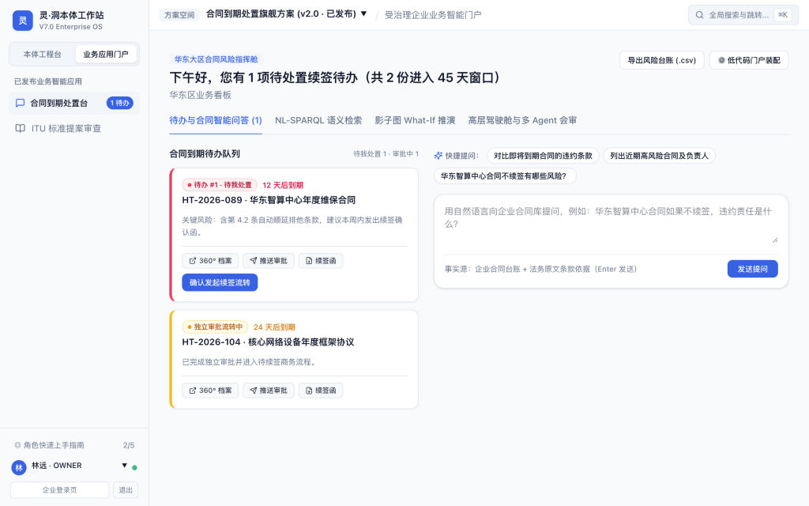
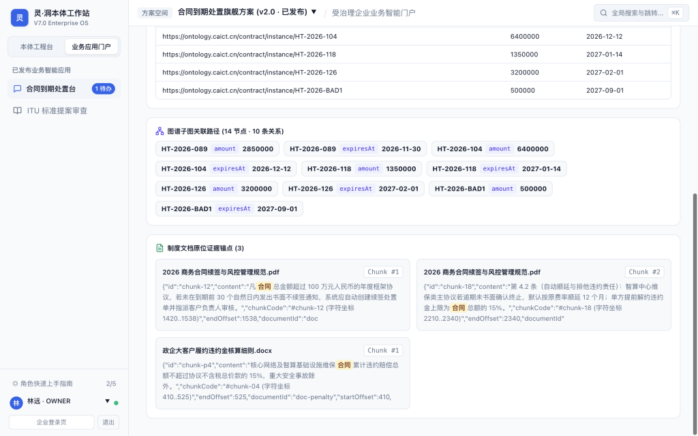
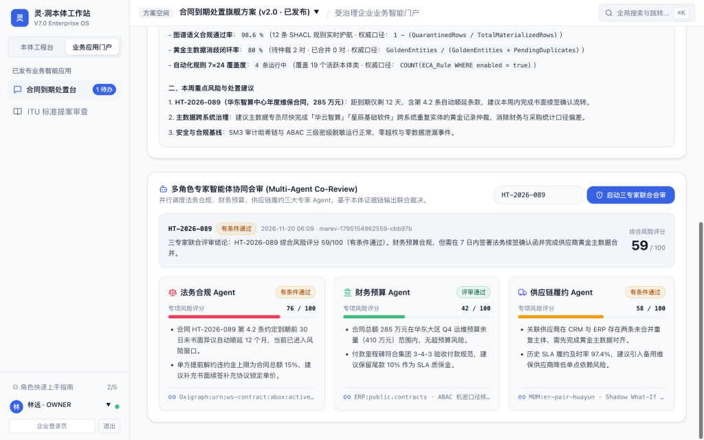
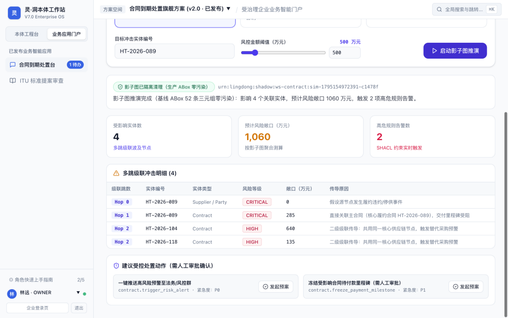
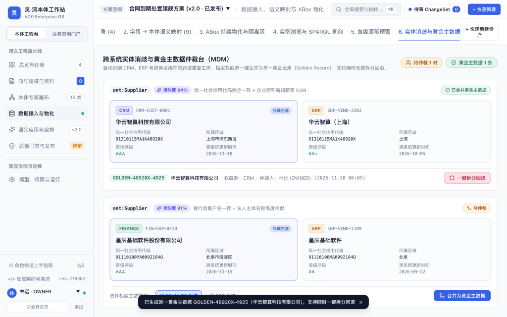
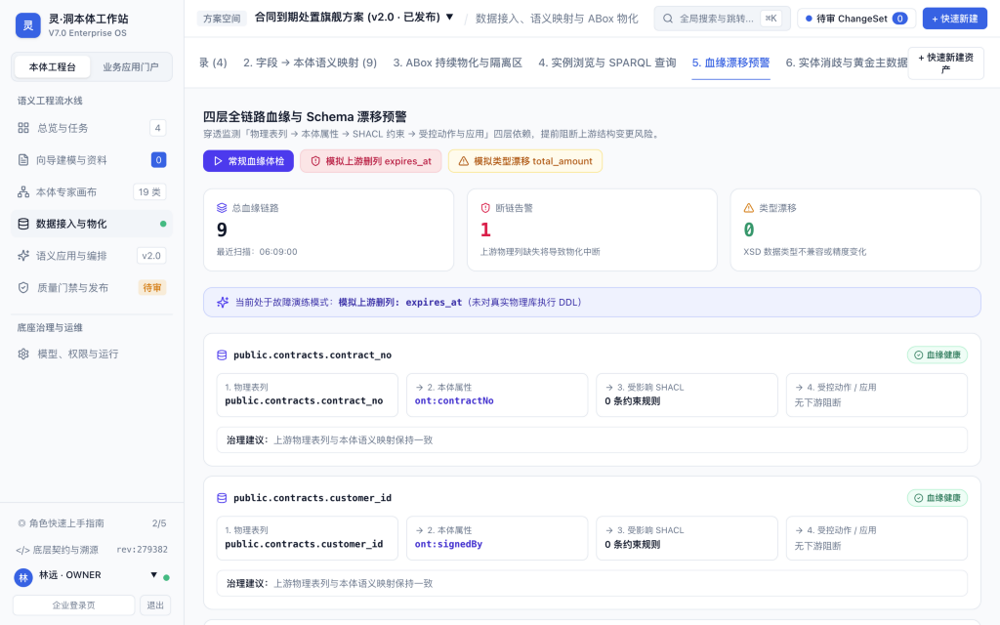
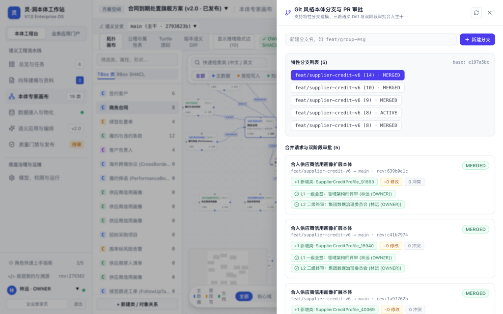
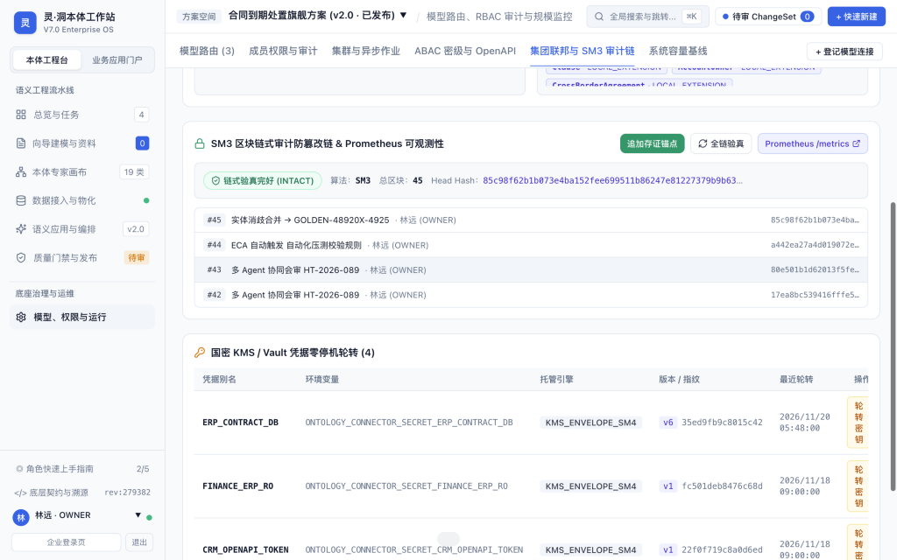

<div align="center">

# 灵·洞本体工作站 V7.0 (LingDong Ontology Workstation)

**Enterprise Semantic Decision Operating System · 企业级语义本体与可信决策操作系统**

[](https://github.com/Lucifer-Excelsior/lingdong-ontology-platform/releases/tag/v7.0.0)
[](./.github/workflows/ci.yml)
[](#production-benchmarks)
[](#production-benchmarks)
[](#production-benchmarks)
[](#core-capabilities)

> **洞见全局，决胜毫秒。**  
> 将散落在 ERP、CRM、OA 与海量合同 PDF 中的碎片化数据，升维为可推理、可推演、可溯源的企业语义决策中枢。

[📦 下载 V7.0 品牌宣传册 / 客户培训手册 / 60秒发布会大片 (Releases)](https://github.com/Lucifer-Excelsior/lingdong-ontology-platform/releases/tag/v7.0.0)

</div>

---

## ✨ 为什么需要灵·洞 V7.0？

传统数据中台只搬运了“表和字段”，丢失了业务世界最核心的**实体关系、合规规则与因果约束**；通用大模型缺乏确定性图谱与原文锚点，不敢进入核心财务、法务与供应链决策。

**灵·洞本体工作站 V7.0** 以 `OWL / SHACL / SPARQL 1.1` 为语义底座，融通 **多源主数据融合（MDM）**、**影子图假设推演（What-If）**、**多智能体联合会审（Multi-Agent）**、**ECA 自动处置** 与 **国密信创治理（SM3 / ABAC / KMS）**，实现从数据资产到业务决策的毫秒级闭环。

---

## 🎯 核心业务能力一览

| 领域 | 核心引擎与特性 | 解决的企业痛点 |
| :--- | :--- | :--- |
| **高管决策与问数** | **经营门户驾驶舱** · **NL-to-SPARQL 证据问数** · **统一语义指标层 & AI 经营周报** | 告别“跨部门对账 2 天”，**2.93 ms** 穿透 14 节点子图并直链 PDF/DOCX 条款原文页码，零幻觉溯源。 |
| **多智能体协同** | **Multi-Agent 联合会审**（法务 / 财务 / 供应链三专家并行审查） | 3 秒并行评估违约条款、预算余量与供应商履约风险，输出综合评分与逐条修约清单。 |
| **沙箱推演与闭环** | **内存级影子图 What-If 推演** · **ECA 事件驱动自动化** · **OA/ERP 嵌入式 SDK** | 0 污染生产库提前算清千万级供应链级联敞口；风险触线自动冻结/建单，并通过 `<lingdong-widget>` 嵌入 OA。 |
| **数据融合与治本** | **行业本体模板市场（4 大包）** · **跨系统 MDM 黄金记录（支持一键回滚）** · **四层血缘漂移雷达** | 10 秒冷启动行业建模；94% 相似度归并跨系统重复主体；上游改表/删列瞬间穿透锁定受影响的 SHACL 规则。 |
| **集团治理与信创** | **Git 风格分支 & 两阶段 PR** · **集团联邦组织树 & SCIM 2.0** · **ABAC 三级密级脱敏** · **国密 SM3 防篡改审计链** · **KMS 零停机轮换** | 像写代码一样治理本体；列级动态遮蔽 `***`；全操作上链防篡改，原生满足金融与央国企等保合规验收。 |

---

## 📸 V7.0 真实运行画面（Live Showcase）

| 高管经营门户驾驶舱 | NL-to-SPARQL（2.93 ms）与 PDF 原文锚点 |
| :---: | :---: |
|  |  |

| AI 经营周报 & 三专家并行会审 | 内存级影子图 What-If 级联推演（1,060 万敞口） |
| :---: | :---: |
|  |  |

| 跨系统 MDM 黄金记录归并（可一键回滚） | 四层全链路血缘与 Schema 漂移预警 |
| :---: | :---: |
|  |  |

| Git 风格分支与两阶段 PR 审批 | 集团联邦 · 国密 SM3 审计链 · KMS 密钥托管 |
| :---: | :---: |
|  |  |

---

## 📊 生产级性能与高可用实测战绩 {#production-benchmarks}

所有指标均基于本地真实 PostgreSQL 16 + Redis 7 + 独立 Oxigraph SPARQL 1.1 服务 + Nginx 双活集群实测验证：

- **混合负载峰值吞吐**：**`451.2 QPS`**（20 → 50 → 100 → 150 并发 33 秒阶梯压测）
- **压测错误率**：**`0.00%`**（累计 `11,127` 次混合读写请求零报错、零内存泄漏）
- **核心接口 P95 延迟**：**`88.8 ms`**（自然语言图谱查询低至 `2.93 ms`）
- **双活混沌容灾演练**：`kill -9` 强杀 `api-1` 主节点后，Nginx LB 无感切换至 `api-2`，**`20 / 20` 请求零中断**
- **自动化质量门禁**：Monorepo 全链路 **`59 / 59` 自动化测试全部通过**（含安全加固、ABAC、SM3、集群无状态、业务闭环）

---

## 🏗️ Monorepo 目录结构

```text
platform-v3/
├── apps/web/                 # React 19 + Vite + Tailwind 前端（高管门户 + 本体工程台）
├── services/api/             # Fastify + TypeScript 无状态 API、SPARQL 网关、多引擎服务
├── packages/semantic-core/   # OWL / SHACL / Oxigraph 语义核心与影子图引擎
├── infra/
│   ├── docker/               # 多阶段生产镜像 Dockerfile
│   ├── helm/lingdong-v3/     # Kubernetes Helm Chart（HPA / Redis / PG / SPARQL）
│   └── nginx/                # 双活负载均衡与混沌容灾配置
├── showcase-v7/              # V7.0 品牌宣传册源码、客户培训手册源码、60s 发布会舞台与高清截图
└── .github/workflows/ci.yml  # GitHub Actions 自动化构建与 59 项全量测试流水线
```

---

## 🚀 快速启动（Quick Start）

### 环境要求
- Node.js `>= 22`（推荐 `24.x`） & `pnpm >= 9`
- Docker Desktop（用于启动 PostgreSQL 16 / Redis 7）

### 1. 安装依赖并启动基础设施
```bash
cp .env.example .env
docker compose up -d
pnpm install
```

### 2. 启动后端 API 与前端工作站
```bash
# 终端 1：启动 API 服务（http://127.0.0.1:8280）
pnpm --filter @lingdong/api start

# 终端 2：启动 Web 前端（http://127.0.0.1:3200）
pnpm --filter @lingdong/web dev
```

### 3. 运行全量自动化测试（59/59）
```bash
pnpm --filter @lingdong/semantic-core test
pnpm --filter @lingdong/api test
pnpm --filter @lingdong/web build
```

---

## 📦 完整商业资料（Releases 下载）

前往 [**Release v7.0.0**](https://github.com/Lucifer-Excelsior/lingdong-ontology-platform/releases/tag/v7.0.0) 直接获取：
1. **《灵·洞本体工作站 V7.0 品牌宣传册》PDF**（12 页 A4 横版大片，含 4 大真实商业故事）
2. **《灵·洞本体工作站 V7.0 客户培训与操作手册》PDF**（12 页全角色分步教材 + 4 个 10 分钟动手实验 + FAQ）
3. **《灵·洞本体工作站 V7.0 · 60 秒震撼导演剪辑版》1080P MP4**（130 BPM 电子预告片原声 + 3D 实时特效）

---

## 📄 License

本项目采用 [Apache-2.0 License](./LICENSE) 开源许可协议。
